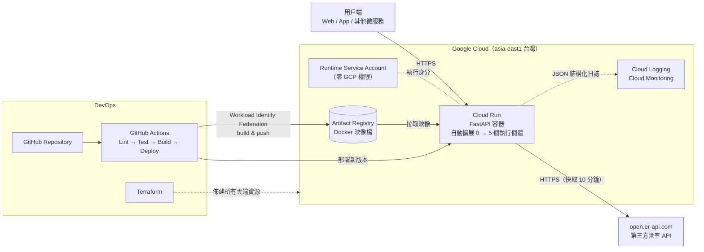
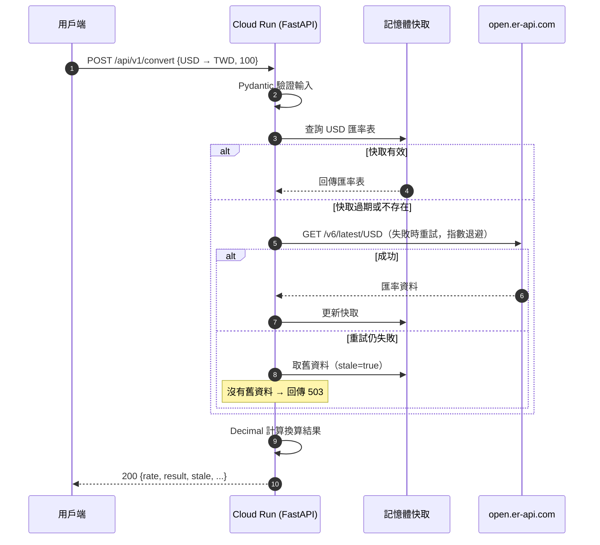
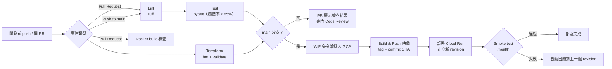
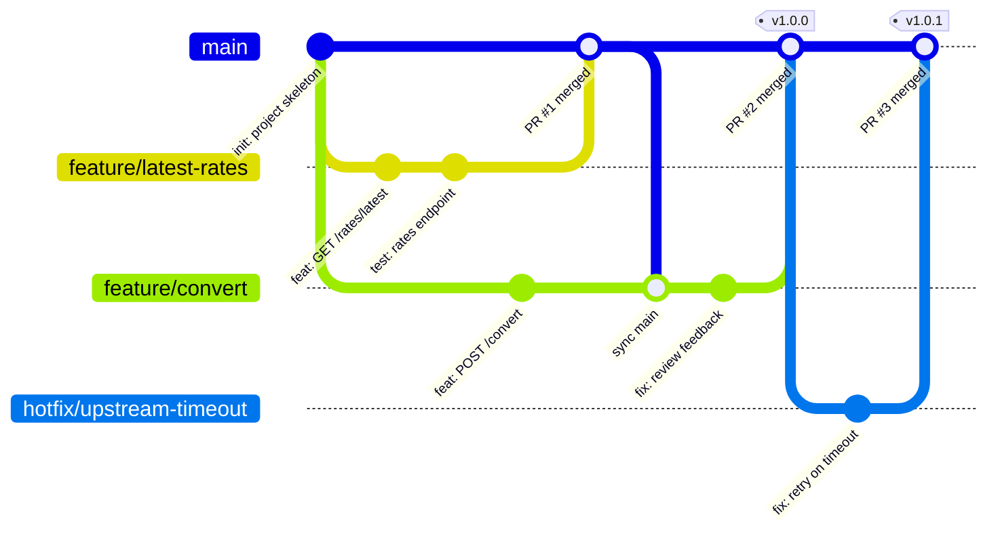
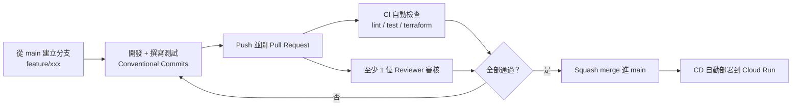

# Exchange Rate Analytics & Conversion API

即時匯率查詢與幣別換算微服務。以 **Python FastAPI** 開發，部署於 **Google Cloud Run**（Serverless 容器），基礎設施以 **Terraform** 管理，並透過 **GitHub Actions** 自動化測試與部署。

| 項目 | 內容 |
|---|---|
| 語言 / 框架 | Python 3.12、FastAPI、Pydantic v2、httpx（非同步） |
| 雲端平台 | Google Cloud Run（asia-east1 台灣） |
| 第三方 API | [ExchangeRate-API 開放端點](https://www.exchangerate-api.com/docs/free)（open.er-api.com） |
| IaC | Terraform（Google provider v6） |
| CI/CD | GitHub Actions + Workload Identity Federation（免金鑰部署） |
| 測試 | pytest，19 個測試案例，覆蓋率約 97% |

> 匯率資料來源：[Rates By Exchange Rate API](https://www.exchangerate-api.com)

---

## 目錄

1. [程式用途與主要功能](#1-程式用途與主要功能)
2. [雲端架構](#2-雲端架構)
3. [雲端服務選用原因](#3-雲端服務選用原因)
4. [API 文件](#4-api-文件)
5. [專案結構](#5-專案結構)
6. [本機開發與測試](#6-本機開發與測試)
7. [部署到 GCP](#7-部署到-gcp)
8. [CI/CD 流程](#8-cicd-流程)
9. [多人協作 Git 流程](#9-多人協作-git-流程)
10. [設計決策](#10-設計決策)
11. [未來改進方向](#11-未來改進方向)
12. [AI 輔助開發心得與 Prompt 運用說明](#12-ai-輔助開發心得與-prompt-運用說明)

---

## 1. 程式用途與主要功能

**情境**：金融服務中，匯率查詢與換算是許多功能的共用基礎（外幣存款試算、海外刷卡試算、旅遊換匯等）。本專案將這項能力獨立成一個**微服務**，讓其他系統透過 REST API 取用，而不必各自串接外部資料源。

**主要功能**

- **最新匯率查詢**：`GET /api/v1/rates/latest`，可指定基準幣別，並篩選回傳的幣別。
- **幣別換算**：`POST /api/v1/convert`，回傳匯率、反向匯率與換算結果。
- **輸入驗證**：幣別格式、金額範圍與小數位數皆由 Pydantic 驗證。
- **統一錯誤格式**：所有錯誤都附帶 `request_id`，方便追查。
- **快取**：減少外部 API 呼叫，提升回應速度。
- **重試與降級**：外部 API 暫時失敗時會自動重試；若有舊資料則回傳並標示 `stale`。
- **網頁前端**：開啟服務網址即可使用換算器與常用幣別牌告，支援手機版面與深色模式。
- **健康檢查與結構化日誌**：`/health` 供 Cloud Run 探測服務狀態，JSON 日誌會整合進 Cloud Logging。

---

## 2. 雲端架構



**請求流程（以換算為例）**



---

## 3. 雲端服務選用原因

### 為什麼選 Cloud Run，而不是 AWS Lambda？

兩者都是 Serverless 方案。我評估後選擇 Cloud Run，主要原因如下：

| 面向 | Cloud Run | AWS Lambda + API Gateway |
|---|---|---|
| 開發方式 | 直接執行標準 Docker 容器，FastAPI 程式不需修改 | 需要 Mangum 等轉接層，把 API Gateway 事件轉成 ASGI |
| 併發模型 | 一個執行個體可同時處理多個請求（本專案設 80） | 一個執行環境同一時間只處理一個請求 |
| 冷啟動 | 併發處理讓需要新開的執行個體較少 | 流量突增時每個新請求都可能遇到冷啟動 |
| 可攜性 | 同一個映像檔也能在本機、Kubernetes 或其他雲執行 | 與 Lambda 執行環境綁定較深 |
| 區域 | asia-east1 位於台灣 | — |

### Scalability（擴展性）

- Cloud Run 依請求量自動增減執行個體（本專案設 0～5），不需要管理伺服器。
- 服務本身是**無狀態**設計，快取只是加速用途，任何一個執行個體都能處理任何請求，因此可以水平擴展。
- 非同步 I/O（httpx.AsyncClient）讓單一執行個體在等待外部 API 時，仍能處理其他請求。

### Cost（成本）

- `min_instances = 0`：沒有流量時不收費，適合流量不穩定的服務。
- `cpu_idle = true`：只在處理請求時計算 CPU 費用。
- `max_instances = 5`：設定上限，避免異常流量造成費用失控。
- 快取 10 分鐘：外部 API 呼叫次數大幅減少，可避免超出免費額度。
- Artifact Registry 清理政策：只保留最近 10 個映像檔，控制儲存成本。

### Security（安全性）

- **免金鑰部署**：GitHub Actions 透過 Workload Identity Federation 以 OIDC 換取短效憑證，repo 中不存放任何 Service Account 金鑰；並限定只有指定的 repository 能使用。
- **最小權限**：執行用的 Service Account 沒有任何 GCP 角色；部署用的 Service Account 只有部署所需的權限。
- **容器安全**：多階段建置縮小映像檔，並以非 root 使用者執行。
- **錯誤處理**：內部錯誤細節只寫入日誌，不回傳給呼叫端。
- **HTTPS**：Cloud Run 預設提供 TLS。

---

## 4. API 文件

啟動後可開啟自動產生的互動式文件：`/docs`（Swagger UI）或 `/redoc`。

### `GET /api/v1/rates/latest`

| 參數 | 位置 | 說明 | 預設 |
|---|---|---|---|
| `base` | query | 基準幣別（ISO 4217 三碼） | `USD` |
| `symbols` | query | 只回傳指定幣別，以逗號分隔 | 全部 |

```bash
curl "https://<service-url>/api/v1/rates/latest?base=USD&symbols=TWD,JPY"
```

```json
{
  "base": "USD",
  "rates": { "TWD": "32.5", "JPY": "150.25" },
  "last_updated_utc": "2026-11-03T00:00:01Z",
  "next_update_utc": "2026-11-04T00:00:01Z",
  "provider": "open.er-api.com",
  "cached": false,
  "stale": false
}
```

### `POST /api/v1/convert`

```bash
curl -X POST "https://<service-url>/api/v1/convert" \
  -H "Content-Type: application/json" \
  -d '{"from_currency": "USD", "to_currency": "TWD", "amount": "100"}'
```

```json
{
  "from_currency": "USD",
  "to_currency": "TWD",
  "amount": "100",
  "rate": "32.500000",
  "inverse_rate": "0.030769",
  "result": "3250.0000",
  "last_updated_utc": "2026-11-03T00:00:01Z",
  "stale": false
}
```

### 錯誤格式

所有錯誤都使用相同的格式：

```json
{
  "error": {
    "code": "validation_error",
    "message": "請求參數格式不正確",
    "request_id": "71c545a1cbff4fbeaa1c7445f0d7db3d",
    "details": [{ "field": "amount", "message": "Input should be greater than 0" }]
  }
}
```

| HTTP | code | 情境 |
|---|---|---|
| 422 | `validation_error` | 參數格式錯誤（金額 ≤ 0、幣別不是三碼等） |
| 422 | `unsupported_currency` | 幣別格式正確，但資料源不支援 |
| 503 | `upstream_unavailable` | 第三方 API 無法使用，且沒有可用的舊資料 |
| 500 | `internal_error` | 未預期錯誤（細節只記錄在日誌） |

---

## 5. 專案結構

```
exchange-rate-api/
├── app/
│   ├── main.py               # FastAPI 進入點：app 工廠、middleware、生命週期
│   ├── config.py             # 環境變數設定（pydantic-settings）
│   ├── schemas.py            # 請求 / 回應模型與驗證
│   ├── exceptions.py         # 自訂例外與統一錯誤處理
│   ├── logging_config.py     # Cloud Logging 相容的 JSON 日誌
│   ├── routers/
│   │   └── rates.py          # /api/v1/rates/latest、/api/v1/convert
│   ├── services/
│   │   ├── rate_client.py    # 第三方 API 用戶端（快取、重試、降級）
│   │   └── converter.py      # 換算邏輯（純函式）
│   └── static/               # 網頁前端（HTML / CSS / JavaScript）
├── tests/
│   ├── conftest.py           # 以 MockTransport 模擬第三方 API
│   ├── test_api.py           # API 測試
│   └── test_frontend.py      # 前端頁面測試
├── terraform/
│   ├── main.tf               # Cloud Run、Artifact Registry、IAM、WIF
│   ├── variables.tf
│   ├── outputs.tf
│   └── terraform.tfvars.example
├── .github/workflows/
│   └── deploy.yml            # CI/CD 流水線
├── docs/
│   └── git-workflow.md       # 協作規範細節
├── Dockerfile                # 多階段建置、非 root 執行
├── requirements.txt          # 執行期相依套件
├── requirements-dev.txt      # 開發 / 測試相依套件
└── pyproject.toml            # ruff、pytest 設定
```

**分層原則**：`routers` 只處理 HTTP 相關工作；`services` 負責商業邏輯與外部串接；`converter` 是不依賴外部服務的純函式，最容易測試。

---

## 6. 本機開發與測試

### 方法一：使用 Docker（最簡單）

電腦已安裝 Docker 的話，只需兩行指令，不必安裝 Python：

```bash
docker build -t exchange-rate-api https://github.com/ellen3149-mogo/exchange-rate-api.git
docker run -p 8080:8080 exchange-rate-api
```

啟動後以瀏覽器開啟 http://localhost:8080 。

### 方法二：使用 Python

需要 Python 3.12 以上與 Git。

**1. 下載專案並建立虛擬環境**

```bash
git clone https://github.com/ellen3149-mogo/exchange-rate-api.git
cd exchange-rate-api
python -m venv .venv
```

**2. 啟用虛擬環境**

```bash
# Windows（PowerShell）
.venv\Scripts\Activate.ps1

# macOS / Linux
source .venv/bin/activate
```

**3. 安裝套件並啟動服務**

```bash
pip install -r requirements-dev.txt
uvicorn app.main:app --port 8080
```

啟動後以瀏覽器開啟：

| 網址 | 內容 |
|---|---|
| http://localhost:8080 | 前端：匯率換算網頁 |
| http://localhost:8080/docs | API 文件（Swagger UI） |

停止服務請按 `Ctrl + C`。

**4. 執行測試與程式碼檢查**

```bash
pytest --cov=app
ruff check .
ruff format --check .
```

測試透過 `httpx.MockTransport` 模擬第三方 API，**不需要網路**。也能模擬正常回應、服務中斷、格式錯誤與不支援的幣別等情境。實際使用前端或 API 時，則需要網路連線以取得真實匯率。

---

## 7. 部署到 GCP

**前置需求**：一個 GCP 專案（已啟用計費）、已安裝 `gcloud` CLI 與 Terraform ≥ 1.6。

```bash
# 1. 登入 GCP
gcloud auth application-default login

# 2. 用 Terraform 建立雲端資源
cd terraform
cp terraform.tfvars.example terraform.tfvars   # 填入 project_id 與 github_repository
terraform init
terraform plan
terraform apply

# 3. 記下輸出值
terraform output workload_identity_provider
terraform output deployer_service_account
```

**4. 設定 GitHub**：到 repo 的 Settings → Secrets and variables → Actions → **Variables**，新增以下變數：

| 名稱 | 值 |
|---|---|
| `GCP_PROJECT_ID` | GCP 專案 ID |
| `GCP_WIF_PROVIDER` | `terraform output workload_identity_provider` 的值 |
| `GCP_DEPLOY_SA` | `terraform output deployer_service_account` 的值 |

**5.** 將程式推送到 `main` 分支，GitHub Actions 就會自動建置並部署。

> Terraform 首次建立 Cloud Run 時，會先使用 Google 的範例映像檔；之後由 CI/CD 部署實際版本。`lifecycle.ignore_changes` 讓 Terraform 不會把映像檔還原成舊版。

---

## 8. CI/CD 流程



**重點設計**

- **PR 階段**：執行 lint、測試、Terraform 驗證與 Docker 建置檢查。全部通過才允許合併，問題可以在進入 main 之前被發現。
- **映像檔標籤使用 commit SHA**：每個版本都可追溯到對應的程式碼，回滾時能明確指定版本。
- **Smoke test 與自動回滾**：部署後檢查 `/health`，失敗就把流量切回上一個 revision。
- **`environment: production`**：可在 GitHub 設定部署前需要人工核准。
- **`concurrency`**：同一分支只保留最新一次執行，避免舊版本覆蓋新版本。

---

## 9. 多人協作 Git 流程

本專案採用 **GitHub Flow**：`main` 永遠保持可部署狀態，所有變更都透過 feature 分支與 Pull Request 合併。這個流程適合「合併即部署」的持續交付模式，也比 Git Flow 輕量。

下圖為分支流程示意，實際的 PR 紀錄請見本 repo 的 [Pull requests](https://github.com/ellen3149-mogo/exchange-rate-api/pulls?q=is%3Apr) 頁面。





**規範摘要**（詳見 [docs/git-workflow.md](docs/git-workflow.md)）

- **分支命名**：`feature/*`、`fix/*`、`hotfix/*`、`docs/*`
- **Commit 訊息**：遵循 [Conventional Commits](https://www.conventionalcommits.org/)，例如 `feat:`、`fix:`、`test:`、`docs:`、`refactor:`
- **main 分支保護**：禁止直接 push，合併前必須通過 CI（多人協作時再加上至少 1 位 Reviewer 審核）
- **合併方式**：Squash merge，讓 main 的歷史紀錄保持清楚
- **版本標記**：以 `vMAJOR.MINOR.PATCH` 標記發佈版本

---

## 10. 設計決策

| 決策 | 原因 |
|---|---|
| 金額使用 `Decimal`，JSON 以字串輸出 | 浮點數會產生誤差（例如 `0.1 + 0.2 ≠ 0.3`），這在金融系統中不能接受；以字串輸出可避免呼叫端解析 JSON 時再次失去精度 |
| 四捨五入使用 `ROUND_HALF_UP` | 符合一般金融計算慣例；Python 預設的「銀行家捨入」不符合一般使用者的預期 |
| 每個 base 一把 `asyncio.Lock` | 快取過期的瞬間，若大量請求同時湧入，只會有一個請求呼叫外部 API（防止 cache stampede） |
| 快取失效時回傳舊資料並標示 `stale` | 匯率資料每日更新，稍舊的資料通常比完全無法服務更有用；`stale` 欄位讓呼叫端自行決定是否採用 |
| 4xx 不重試、5xx 與網路錯誤才重試 | 4xx 代表請求本身有問題，重試也不會成功，只會浪費資源 |
| `create_app()` 工廠函式 | 測試時可注入假的 HTTP transport，不依賴網路，測試結果穩定 |
| 每個請求帶 `X-Request-ID` | 錯誤回應與日誌使用同一個 ID，客服或維運人員可以快速找到對應的紀錄 |

---

## 11. 未來改進方向

- **分散式快取**：目前每個執行個體各有一份快取；流量變大時可改用 **Memorystore（Redis）** 讓所有執行個體共用。
- **API 驗證與流量控制**：若改為內部服務，可加上 API Gateway 或 Cloud Endpoints，進行 API Key / JWT 驗證與 rate limiting。
- **歷史匯率與分析**：以 Cloud Scheduler 定時抓取匯率並存入 Firestore 或 BigQuery，提供走勢與波動度分析端點。
- **多資料源備援**：增加第二個匯率資料源，主資料源失效時自動切換。
- **可觀測性**：導入 OpenTelemetry 與 Cloud Trace，並以 Cloud Monitoring 設定錯誤率與延遲告警。
- **多環境部署**：以 Terraform workspace 或獨立變數檔區分 dev / staging / prod。

---

## 12. AI 輔助開發心得與 Prompt 運用說明

本專案使用 **Claude**（Anthropic）作為 AI 輔助開發工具。我把 AI 定位為「資深工程師搭檔」：由我提出需求並做最後的判斷與驗證，AI 協助產生初版程式並提出設計建議。

### 使用方式

| 階段 | AI 協助的內容 | 我負責的工作 |
|---|---|---|
| 需求分析 | 列出匯率 API 常見的功能與邊界情況 | 決定應用情境、雲端平台、語言與交付項目 |
| 架構設計 | 比較 Cloud Run 與 Lambda 的優缺點 | 理解兩者的取捨，確認選用 Cloud Run 的理由 |
| 程式實作 | 產生 FastAPI 程式、快取與重試邏輯 | 針對不理解的設計追問原因，確保自己能說明每個決策 |
| 測試 | 撰寫測試案例（服務中斷、格式錯誤、快取命中等） | 在自己的 Windows 環境執行測試，並透過 Swagger UI 實際呼叫 API 驗證結果 |
| IaC / CI/CD | 產生 Terraform 與 GitHub Actions 設定 | 推上 GitHub，以 PR 流程觀察 CI 自動執行 lint、測試、Docker 建置與 Terraform 驗證 |
| 文件 | 協助整理 README 架構 | 閱讀第三方 API 文件，依使用條款補上資料來源標示（PR #1） |

### Prompt 運用技巧

**1. 角色設定與完整背景**：先告訴 AI 它扮演的角色，以及專案的用途和限制，產出會比直接要求「寫一個 API」更貼近需求。

```text
請扮演資深雲端架構師與 Senior Backend Engineer。
我要做一個匯率查詢與換算微服務，
需要部署在 Serverless 平台，並說明 Scalability、Cost、Security 的考量。
```

**2. 明確列出交付項目**：把需要的端點、檔案與規範逐條列出，避免 AI 遺漏或自行擴充範圍。

**3. 要求說明「為什麼」**：不只問「怎麼寫」，也追問設計原因，例如「為什麼金額要用 Decimal 而不是 float？」「PR 是什麼？為什麼要這樣協作？」，確保自己真正理解每個決策。

**4. 以測試驗證 AI 的產出**：AI 產生的程式不一定正確。開發過程中，測試就抓到了 AI 初版程式的問題：

- 模擬「第三方 API 回傳格式錯誤」的測試失敗，原因是程式漏捕捉 `AttributeError`，導致回傳 500 而不是預期的 503，補上後測試才通過。
- 手動測試時發現 503 錯誤訊息帶出了內部的網路錯誤細節（`Errno -2`），可能洩漏系統資訊，後來改為只回傳通用訊息，詳細內容寫入日誌。

### 心得

1. **AI 大幅縮短了「從零到可執行」的時間**，讓我能把更多時間花在理解架構取捨、測試與安全性這些更需要判斷的地方。
2. **AI 的產出需要驗證**。上面兩個問題都是靠測試才發現的，這讓我體會到：撰寫測試不只是為了覆蓋率，也是檢驗 AI 產出最有效的方法。
3. **「能執行」和「看得懂」是兩回事**。我刻意追問每個設計背後的原因，而不只是確認程式能跑。
4. **好的 Prompt 來自清楚的需求**。當我能明確描述限制與目標時，AI 的產出品質明顯提升；反過來說，寫 Prompt 的過程也幫助我釐清自己的需求。
